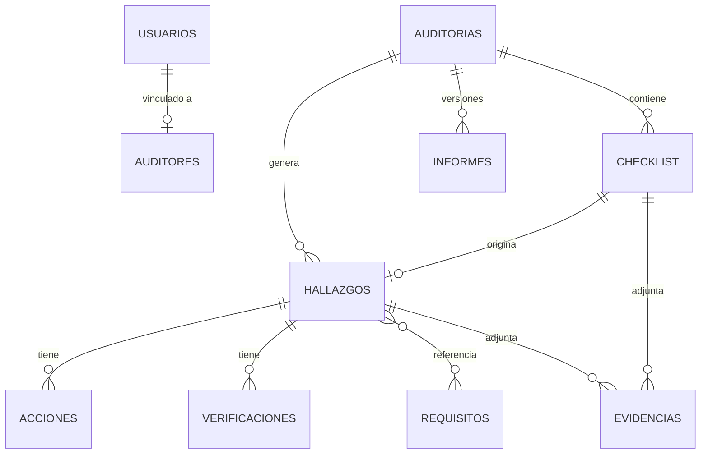
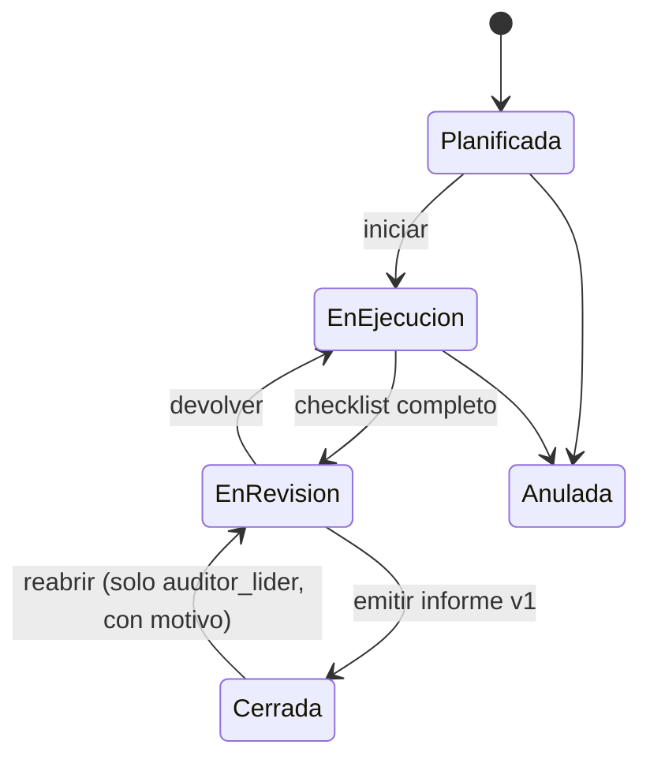

# FMA_AuditoriAPP — Fase 0: Especificación funcional y técnica

**Versión:** 0.1 (borrador para validación)
**Fecha:** 15-09-2026
**Autor:** Jarvis para Isma (auditor líder)
**Fuentes:** "PROMPTS PARA DESARROLLO DE LA APP DE AUDITORÍA INTERNA.docx", "Informe auditoria interno versión N°10 2024.docx" y las normas ISO 9001:2015, 14001:2015 y 45001:2018 de la carpeta del proyecto.

---

## 1. Decisiones ya tomadas

| # | Decisión | Consecuencia en el diseño |
|---|---|---|
| D1 | Solo los auditores usan la app. Los jefes de área no tienen cuenta. | El auditor registra lo que el jefe de área comprometa: corrección, causa y acciones. El "responsable" de una acción se guarda como texto (nombre y cargo), no como usuario. |
| D2 | La auditoría se desarrolla dentro de la app. | La app es el lugar de trabajo: plan, checklist en terreno, hallazgos, seguimiento e informe. El Word es solo una **salida** que replica la plantilla v10. |
| D3 | Clasificación: **NC** (No Conformidad) y **OM** (Oportunidad de Mejora). | Enum cerrado `NC` / `OM`. |
| D4 | Firebase en una cuenta existente. | Ver sección 7.2 (almacenamiento de fotos sin Cloud Storage). |
| D5 | Notificaciones fuera de alcance por ahora. | Sin Cloud Functions. Las alertas (vencidos, próximos) se calculan en pantalla al abrir la app. |

---

## 2. Datos maestros extraídos de la plantilla v10

| Catálogo | Valores iniciales |
|---|---|
| Sucursales | Santiago, Antofagasta |
| Áreas | Control de Calidad, Post Venta, Diseño y planos de fabricación, Producción, Recursos humanos, Adquisiciones, Prev. de riesgos y medio ambiente, Ventas, Gerencia General, Bodega |
| Auditores (catálogo, sin cuenta necesariamente) | Ismael Arelluna, Cristian Gatica, Cristian Neira, Aldo Aravena, Israel Contreras, Gisela González, Denisse Torres, Eva Duarte, Lucio D´Amico, Evelyn Araya, Luis González, Katherine Molina |
| Normas | ISO 9001:2015, ISO 14001:2015, ISO 45001:2018 |
| Tipo de hallazgo | NC, OM |
| Nivel | BAJA, MEDIA, ALTA |
| Formato N° auditoría | `NN/AAAA` (ej. `01/2026`) |
| Encabezado del informe | "INFORME DE AUDITORÍA INTERNA — Versión 10 / 2024" + logo FMA |

> **Distinción importante:** **auditores** (12 personas que pueden integrar un equipo) no es lo mismo que **usuarios** (3 personas con login). Un auditor puede figurar en el equipo de una auditoría sin tener cuenta.

---

## 3. Alcance por etapas

### Etapa 1: MVP (lo mínimo para auditar de punta a punta dentro de la app)

1. **Acceso:** login, perfil y gestión de usuarios (solo auditor líder), sin registro abierto.
2. **Catálogos:** sucursales, áreas, auditores y requisitos por cláusula de cada norma.
3. **Auditorías:** crear, correlativo automático, equipo, normas, objetivos, alcance y una agenda simple.
4. **Checklist en terreno:** preguntas por requisito, resultado, evidencia observada y fotos. Un ítem NC/OM crea el hallazgo precargado.
5. **Hallazgos:** tipo, requisitos, descripción, nivel, fecha límite y evidencias.
6. **Seguimiento:** corrección, análisis de causa raíz, acciones correctivas (1 a N) y verificación de eficacia.
7. **Informe en la app:** vista idéntica a la plantilla v10, notas, aprobación, versiones y **exportación a Word**.
8. **Bitácora** de cambios (trazabilidad, cláusula 7.5).
9. **Dashboard básico:** 4 tarjetas resumen y lista de hallazgos vencidos o próximos a vencer.
10. Caché sin conexión de Firestore activado (base para trabajar en planta).

### Etapa 2

- Programa anual de auditorías (vista y aprobación).
- Plantillas de checklist reutilizables por área o proceso.
- Dashboard completo: gráficos y filtros del Prompt 4.
- Calendario: auditorías y fechas límite derivadas, más eventos propios.
- Búsqueda global.
- PWA instalable en tablet o celular.

### Etapa 3

- Reportes avanzados por auditor, área y tendencia.
- Exportación a Excel y PDF.
- Tema oscuro y preferencias.
- Notificaciones, si se revierte la decisión D5.

---

## 4. Modelo de datos (Firestore)

### 4.1 Mapa de entidades

### 4.2 Colecciones

**`usuarios/{uid}`** (uid de Firebase Auth)
`nombre, email, rol ('auditor_lider' | 'auditor_sistema' | 'auditor'), auditorId, activo, creadoEn, actualizadoEn`

**`auditores/{id}`**
`nombre, cargo, sucursalId, areaOrigenId, normasCompetencia[], activo`

**`sucursales/{id}`**: `nombre, activo`
**`areas/{id}`**: `nombre, activo`

**`requisitos/{id}`**
`norma ('9001' | '14001' | '45001'), clausula ('7.5.3'), titulo, orden, activo`
> Se cargan desde las normas de la carpeta: **solo número y título de cada cláusula**, no el texto de la norma.

**`contadores/auditorias_{año}`**: `ultimoNumero` (se incrementa con una transacción).

**`auditorias/{id}`**

| Campo | Tipo | Nota |
|---|---|---|
| numero, anio, codigo | number, number, string | `codigo = "01/2026"` |
| sucursalId, areaId | ref | |
| objetivos, alcance | string | con texto por defecto de la plantilla |
| normas[] | string[] | |
| auditorLiderId, equipoIds[] | ref auditores | |
| auditadosTexto | string | jefe o encargado de área (sin cuenta) |
| fechaPlanificada, fechaRealizacion | timestamp | |
| agenda[] | `{fecha, hora, proceso, auditado, auditorId}` | |
| estado | enum | ver 5.1 |
| notas | string | sección NOTAS del informe |
| auditoriaAnteriorId | ref | para verificar acciones de la auditoría anterior |
| resumen | `{nc, om, abiertos, tratados}` | desnormalizado para el dashboard |
| motivoAnulacion | string | |
| creadoPor, creadoEn, actualizadoEn | | |

**`auditorias/{id}/checklist/{itemId}`**
`orden, pregunta, requisitoIds[], resultado ('pendiente' | 'conforme' | 'NC' | 'OM' | 'no_aplica'), evidenciaObservada, auditorId, hallazgoId, evidenciaIds[]`

**`hallazgos/{id}`** (colección raíz, para consultar entre auditorías y en el dashboard)

| Campo | Nota |
|---|---|
| auditoriaId, correlativo | correlativo 1..n dentro de la auditoría (columna "Id" del informe) |
| anio, sucursalId, areaId | copiados de la auditoría, para filtros |
| tipo | `NC` / `OM` |
| requisitoIds[], normas[] | `normas` derivado |
| descripcion | texto multilínea simple |
| nivel | `BAJA` / `MEDIA` / `ALTA` (pendiente de confirmar, P1) |
| fechaDeteccion, fechaLimite | |
| auditorResponsableId | |
| checklistItemId | origen, opcional |
| correccion | "cómo se solucionó la evidencia" |
| analisisCausa | `{metodo: '5porques' \| 'ishikawa' \| 'otro', porques[], causaRaiz}` |
| estado | **derivado**, ver 5.2 |
| evidenciaIds[] | |

**`hallazgos/{id}/acciones/{accionId}`**
`tipo ('correctiva' | 'mejora'), descripcion, responsable (texto), fechaCompromiso, fechaImplementacion, implementada (bool)`

**`hallazgos/{id}/verificaciones/{verifId}`**
`fecha, auditorId, auditoriaId (en qué auditoría se verificó), resultado ('eficaz' | 'no_eficaz'), analisis, nivel`

**`evidencias/{id}`**
`auditoriaId, hallazgoId, checklistItemId, descripcion, mime, ancho, alto, bytes, datos (base64) | storagePath, subidoPor, creadoEn` (ver 7.2)

**`auditorias/{id}/informes/{version}`**
`version, estado ('borrador' | 'emitido'), snapshot (JSON congelado con los datos del informe), aprobaciones[] {rol, nombre, usuarioId, fecha}, emitidoPor, emitidoEn`
> El informe emitido guarda un **snapshot**, no el archivo. El Word se regenera idéntico desde el snapshot, así que no hace falta Storage para los informes.

**`bitacora/{id}`**
`entidad, entidadId, auditoriaId, accion ('crear' | 'editar' | 'cambio_estado' | 'emitir' | 'anular' | 'reabrir'), cambios {campo: {antes, despues}}, usuarioId, fecha`
Solo se puede crear; no se edita ni se borra.

---

## 5. Reglas de negocio

### 5.1 Estados de la auditoría

### 5.2 Estado del hallazgo (derivado, no se elige a mano)

El Prompt 6 proponía un selector manual de estado. Lo descarto porque permite marcar "tratada" una NC sin acciones ni verificación, y eso es justo lo que observa un auditor externo.

| Estado visible | Condición |
|---|---|
| **No tratada** | sin acciones registradas |
| **En seguimiento** | con acciones, sin verificación eficaz vigente |
| **Tratada** | última verificación = `eficaz` |
| (marca) **Vencido** | `fechaLimite < hoy` y estado ≠ Tratada |

### 5.3 Reglas

| Código | Regla |
|---|---|
| RN-01 | Correlativo por año, asignado al crear mediante una transacción. Nunca se reutiliza: una auditoría anulada conserva su número. |
| RN-02 | **Independencia:** un auditor no puede integrar una auditoría de su propia área de origen. La app lo bloquea; el auditor líder puede forzarlo con motivo, que queda en la bitácora. |
| RN-03 | Todo hallazgo requiere al menos un requisito, una descripción y un nivel. |
| RN-04 | **NC:** para pasar a "En seguimiento" exige corrección, análisis de causa raíz y al menos una acción correctiva con responsable y fecha de compromiso. |
| RN-05 | **OM:** acción de mejora recomendada, no obligatoria (pendiente de confirmar, P2). |
| RN-06 | La verificación de eficacia exige que todas las acciones estén implementadas, y su fecha debe ser igual o posterior a la última implementación. |
| RN-07 | Resultado `no_eficaz`: el hallazgo vuelve a "En seguimiento" y exige una nueva acción. El historial se conserva. |
| RN-08 | Para pasar a "En revisión", ningún ítem del checklist puede quedar `pendiente`. |
| RN-09 | Cerrar una auditoría bloquea el checklist y la descripción de los hallazgos, pero **no** bloquea acciones ni verificaciones: el seguimiento continúa. |
| RN-10 | El informe emitido es inmutable. Registrar seguimiento o eficacia posterior genera una **nueva versión** (v2, v3…), igual que la plantilla, que incluye seguimiento y eficacia. |
| RN-11 | No se borran auditorías ni hallazgos con datos: se **anulan** con motivo. Solo el auditor líder puede hacerlo. |
| RN-12 | Toda creación, edición, cambio de estado, emisión, anulación o reapertura queda en la bitácora. |
| RN-13 | Las fotos se comprimen en el dispositivo (máx. 1600 px, JPEG) antes de guardarse. |
| RN-14 | La verificación de eficacia de hallazgos de una auditoría anterior puede hacerse desde la auditoría actual (`auditoriaAnteriorId`), coherente con el objetivo por defecto de la plantilla. |

---

## 6. Roles y permisos

| Acción | auditor_lider | auditor_sistema | auditor |
|---|:-:|:-:|:-:|
| Ver todas las auditorías | ✅ | ✅ | Solo donde es líder o integra el equipo |
| Crear o editar auditoría | ✅ | ✅ | ❌ |
| Checklist, hallazgos y seguimiento | ✅ | ✅ | ✅ en sus auditorías |
| Emitir informe | ✅ | ✅ si es líder de esa auditoría | ❌ |
| Anular o reabrir | ✅ | ❌ | ❌ |
| Catálogos (áreas, sucursales, auditores, requisitos) | ✅ | ✅ | ❌ |
| Usuarios y roles | ✅ | ❌ | ❌ |
| Ver bitácora | ✅ | ✅ | Solo de sus auditorías |

- El rol vive en `usuarios/{uid}.rol`, nunca en el código. Las reglas de seguridad de Firestore lo leen con `get()`.
- Como no usamos Cloud Functions, el auditor líder crea las cuentas desde la app con una **instancia secundaria de Firebase**, para no cerrar su propia sesión. La contraseña inicial se gestiona con correo de restablecimiento.

---

## 7. Decisiones técnicas

### 7.1 Stack

| Capa | Elección | Motivo |
|---|---|---|
| Base | React + Vite + TypeScript | Lo definido en el prompt |
| UI | Tailwind CSS + shadcn/ui | Componentes accesibles, livianos y personalizables con la identidad FMA |
| Formularios | React Hook Form + Zod | Validaciones de RN-03/04/06 declaradas una sola vez y tipadas |
| Tablas | TanStack Table | Filtros, orden y paginación sin inventar nada |
| Gráficos | Recharts | Suficiente para el dashboard |
| Fechas | date-fns (locale `es`) | |
| Word | `docx` (npm) | Genera .docx en el navegador |
| Fotos | browser-image-compression | RN-13 |
| IDs | IDs automáticos de Firestore | Se elimina `uuid`, no aporta |
| Texto largo | Área de texto simple | **Se descarta el editor enriquecido**: complica la exportación a Word y no aporta valor de auditoría |

### 7.2 Fotos de evidencia sin Cloud Storage

Desde fines de 2024, Cloud Storage for Firebase exige el plan Blaze (con tarjeta, aunque tenga cuota gratuita). Hay dos opciones:

| | A. Cloud Storage (plan Blaze) | B. Fotos comprimidas en Firestore |
|---|---|---|
| Costo | Prácticamente $0 a esta escala, pero requiere tarjeta | $0 en plan Spark |
| Límite | Amplio | ~1 GiB gratis. Con fotos de ~200 KB son unas 5.000 fotos |
| Sin conexión en planta | La subida no queda en cola | ✅ Queda en cola y se sincroniza sola |
| Archivos no imagen (PDF, video) | ✅ | ❌ (máx. ~700 KB por documento) |

**Recomendación: B para el MVP.** El volumen estimado (2 sucursales, pocas auditorías al año, unas 10 a 20 fotos por auditoría) queda muy por debajo del límite, y además funciona sin conexión, que es clave en planta. Se implementa detrás de una interfaz `EvidenceStore`, así que migrar a Storage más adelante toca un solo archivo. La desventaja es que no es la vía "canónica" y descarta PDF y videos como evidencia.

### 7.3 Entornos y seguridad

- Dos proyectos Firebase en la misma cuenta: `fma-auditoriapp-dev` y `fma-auditoriapp-prod`.
- Reglas de Firestore probadas con Firebase Emulator antes de cada despliegue.
- Variables en `.env` (nunca en el repositorio) y en Netlify.
- Sin registro abierto. Cuentas inactivas bloqueadas por reglas (`usuarios.activo == true`).

### 7.4 Informe dentro de la app

1. La pestaña **Informe** de cada auditoría muestra en vivo la misma estructura de la plantilla v10: metadata, índice, resultados, notas, seguimiento, eficacia, evidencia fotográfica y aprobación.
2. Los datos no se escriben dos veces: salen del checklist, los hallazgos, las acciones y las verificaciones. Lo único editable ahí son las **Notas**.
3. **Aprobación:** el auditor líder y el equipo aprueban con su usuario (nombre y fecha). El jefe de área firma en el documento impreso o PDF, o el auditor registra su visto bueno (pendiente, P3).
4. **Emitir** congela un snapshot y crea la versión. **Exportar Word** genera el .docx con el formato v10.
5. **Requisito:** necesito el logo FMA en PNG o SVG. En la plantilla está en formato EMF, que el navegador no puede usar.

---

## 8. Pendientes por confirmar

| # | Pregunta | Propuesta por defecto |
|---|---|---|
| P1 | "Nivel de importancia" (tabla de eficacia) e "impacto" (hallazgo), ¿son lo mismo? | Un solo campo `nivel` en el hallazgo, que se muestra en la tabla de eficacia |
| P2 | ¿Las OM exigen acción y verificación para cerrarse? | Acción opcional. Si no se implementa, el líder la cierra con justificación |
| P3 | Aprobación del jefe de área | Visto bueno registrado por el auditor (nombre, fecha) más firma física en el PDF |
| P4 | Almacenamiento de fotos | Opción B (Firestore) |
| P5 | Área de origen de cada uno de los 12 auditores (para RN-02) | La completa Isma en el catálogo |
| P6 | Logo FMA en PNG/SVG | — |
| P7 | ¿El auditor_sistema puede emitir informes? | Solo si es líder de esa auditoría |

---

## 9. Plan de construcción de la Etapa 1 (reemplaza el orden de los prompts)

| Sprint | Entregable |
|---|---|
| S1 | Setup del proyecto, Firebase dev/prod, auth, usuarios, roles, reglas base, layout y catálogos con carga inicial |
| S2 | Auditorías (CRUD, correlativo, equipo, independencia, agenda) y bitácora |
| S3 | Checklist en terreno, hallazgos y evidencias con compresión y caché sin conexión |
| S4 | Seguimiento: corrección, causa raíz, acciones, verificación y estados derivados |
| S5 | Informe en la app, versiones, exportación Word v10 y dashboard básico |
| S6 | Pruebas de reglas y flujos, auditoría piloto real, ajustes y deploy a producción en Netlify |

Criterio de término del MVP: realizar **una auditoría interna real de punta a punta** en la app y obtener el informe Word sin editarlo a mano.
